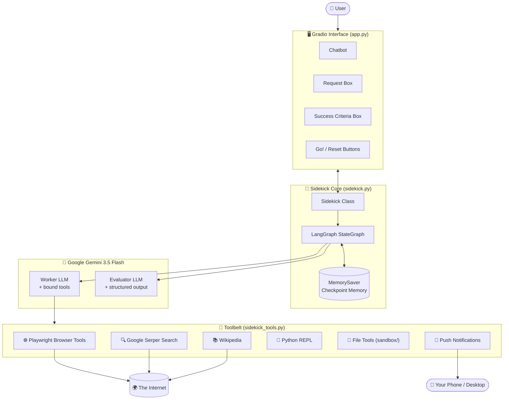
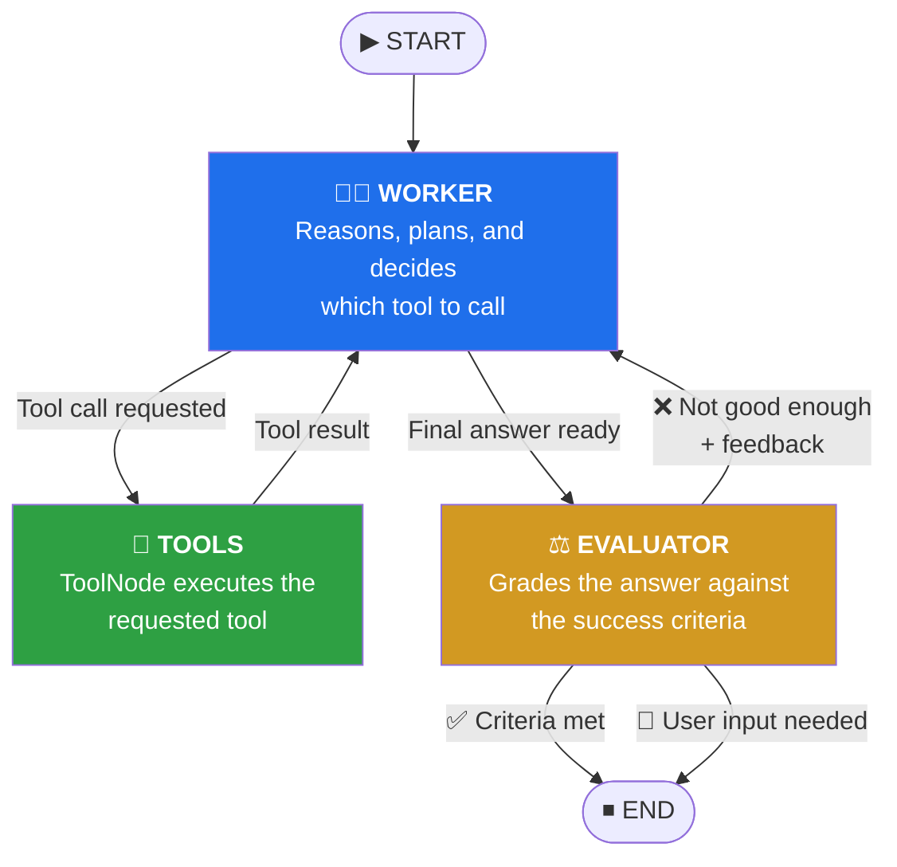
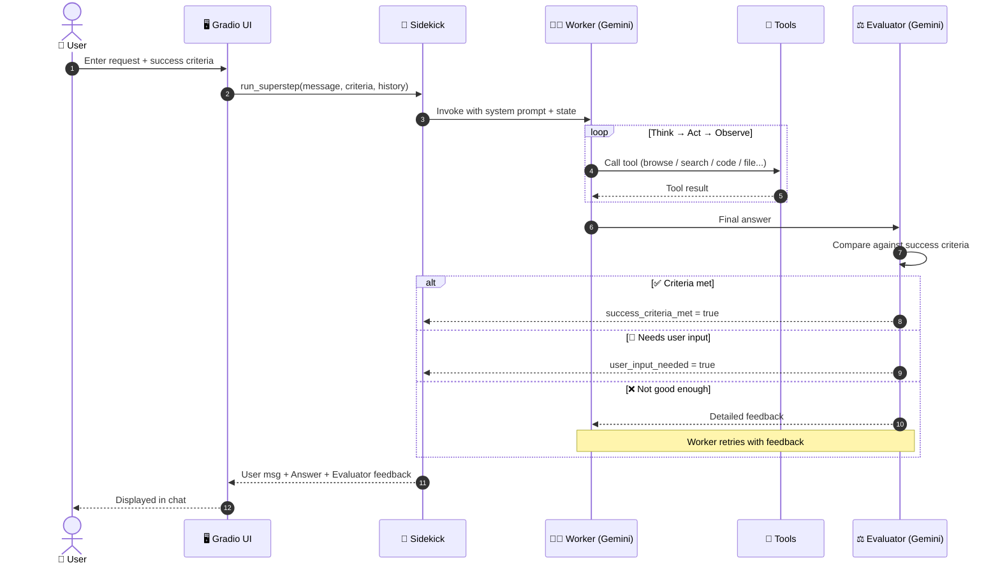
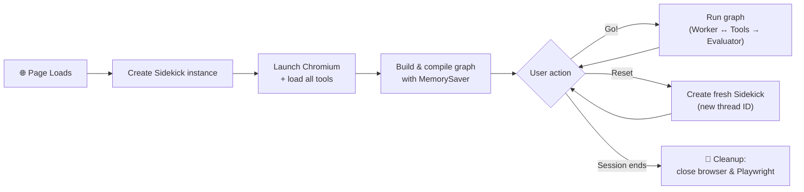

<div align="center"> 

# 🚀 Sidekick AI

 

### 🧠 Stop Getting Answers. Start Getting *Verified* Answers.

 

#### The autonomous AI agent that surfs the web, scrapes data, writes and runs code, manages files and pings your phone, then puts its own work on trial before you ever see it.

 

[Python](https://img.shields.io/badge/Python-3.11+-3776AB?logo=python&logoColor=white) [LangGraph](https://img.shields.io/badge/Orchestration-LangGraph-1C3C3C) [Gemini](https://img.shields.io/badge/LLM-Gemini%203.5%20Flash-4285F4?logo=google&logoColor=white) [Playwright](https://img.shields.io/badge/Browser-Playwright-2EAD33?logo=playwright&logoColor=white) [Gradio](https://img.shields.io/badge/UI-Gradio-FF7C00) [uv](https://img.shields.io/badge/Package%20Manager-uv-DE5FE9)

 

**One AI does the work. A second AI cross-examines it. Your success criteria decide the verdict.**

 

**No more sloppy answers. No more hallucination anxiety. No more blindly trusting a single LLM.**

 </div> 

---

 

## 📑 Table of Contents

 

1. [Introduction](https://claude.ai/chat/9091af15-0ee2-4ba7-90dd-570f281c8622#-introduction)
2. [The Problem](https://claude.ai/chat/9091af15-0ee2-4ba7-90dd-570f281c8622#-the-problem)
3. [The Solution](https://claude.ai/chat/9091af15-0ee2-4ba7-90dd-570f281c8622#-the-solution-why-sidekick-ai-is-a-game-changer)
4. [What Sidekick Can Do](https://claude.ai/chat/9091af15-0ee2-4ba7-90dd-570f281c8622#-what-sidekick-can-do)
5. [Key Features](https://claude.ai/chat/9091af15-0ee2-4ba7-90dd-570f281c8622#-key-features)
6. [Architecture](https://claude.ai/chat/9091af15-0ee2-4ba7-90dd-570f281c8622#-architecture)
7. [The Toolbelt](https://claude.ai/chat/9091af15-0ee2-4ba7-90dd-570f281c8622#-the-toolbelt)
8. [Tech Stack](https://claude.ai/chat/9091af15-0ee2-4ba7-90dd-570f281c8622#-tech-stack)
9. [Project Structure](https://claude.ai/chat/9091af15-0ee2-4ba7-90dd-570f281c8622#-project-structure)
10. [Getting Started](https://claude.ai/chat/9091af15-0ee2-4ba7-90dd-570f281c8622#-getting-started)
11. [Usage Guide](https://claude.ai/chat/9091af15-0ee2-4ba7-90dd-570f281c8622#-usage-guide)
12. [Configuration](https://claude.ai/chat/9091af15-0ee2-4ba7-90dd-570f281c8622#-configuration)
13. [Security Notes](https://claude.ai/chat/9091af15-0ee2-4ba7-90dd-570f281c8622#-security-notes)
14. [Troubleshooting](https://claude.ai/chat/9091af15-0ee2-4ba7-90dd-570f281c8622#-troubleshooting)
15. [Roadmap](https://claude.ai/chat/9091af15-0ee2-4ba7-90dd-570f281c8622#-roadmap)
16. [Author](https://claude.ai/chat/9091af15-0ee2-4ba7-90dd-570f281c8622#-author)

 

---

 

## 🌟 Introduction

 

**Sidekick AI** is a next-generation autonomous AI agent that behaves less like a chatbot and more like a **real digital co-worker**.

 

You don't just ask it a question. You hand it a **task** and tell it what **"done" looks like** (your *success criteria*). Sidekick then goes off and gets it done. It opens a real browser, searches the internet, reads Wikipedia, writes and executes Python code, creates files, and pings your phone when it has something to tell you.

 

Here's the part that changes everything: **Sidekick doesn't just answer, it audits itself.**

 

Every LLM has the same dirty secret: it will happily hand you a confident, polished, *wrong* answer. Sidekick is built to fight exactly that. Every response is reviewed by a second, independent AI **Evaluator** that cross-examines the work against *your* success criteria before it reaches you.

 

- ⚖️ The Evaluator **judges the answer on its merits**. It doesn't rubber-stamp whatever the Worker says, and it doesn't follow your criteria blindly either. It weighs whether the answer genuinely holds up.
- 📝 It writes **feedback on how well the answer stands**, shown right in the chat, so you can see *how much to trust* what you're reading instead of just hoping.
- 🔁 If the work falls short, the Evaluator sends detailed feedback to the Worker, and the Worker **tries again**, until the result meets your standard.
- 🙋 If the agent is stuck, or something is unclear, it **stops and asks you** instead of making things up.

 

The Worker has a full toolbelt to back its answers with real evidence: it **browses and scrapes live websites**, **searches Google**, **reads Wikipedia**, **writes and runs Python**, **creates and manages files**, and **sends you a push notification** when it's done.

 

> **No more slop. No more hallucination anxiety. No more babysitting. Just answers you can actually trust.**

 

Built on **LangGraph**, powered by **Google Gemini 3.5 Flash**, driven by a live **Playwright** browser, and wrapped in a clean **Gradio** interface.

 

---

 

## 😤 The Problem

 

Today's AI assistants are impressive, and also deeply frustrating. Anyone who has used them for real work has hit these walls:

 

- ❌ **One-shot answers.** You ask, it replies once, and if the answer is wrong or incomplete, *you* have to notice, re-prompt, and repeat.
- ❌ **No quality control.** Nothing checks whether the response actually satisfies what you needed. The AI is both the student *and* the examiner.
- ❌ **Stuck in a text box.** Most chatbots can't browse live websites, run code, or touch your files. They can only *talk about* doing things.
- ❌ **Stale knowledge.** Without live web access, answers are frozen at the model's training date.
- ❌ **Manual glue work.** Researching, then coding, then saving results to a file, then sharing them means *you* become the integration layer between five different tools.
- ❌ **Constant supervision.** Long tasks need you to sit and watch. There's no way for the AI to say "I'm done, come look" or "I'm stuck, I need you."
- ❌ **Vague success.** Nobody defines what a "good" result looks like up front, so quality is subjective and inconsistent.

 

---

 

## 💡 The Solution: Why Sidekick AI Is a Game-Changer

 

Sidekick AI attacks every one of those problems at the architectural level, not with a clever prompt, but with a **closed-loop, self-correcting agent design**.

 


| ❌ The Problem        | ✅ How Sidekick Solves It                                                                                            |
| -------------------- | ------------------------------------------------------------------------------------------------------------------- |
| One-shot answers     | A **Worker ↔ Tools loop** lets the agent think, act, observe, and keep going across as many steps as the task needs |
| No quality control   | A dedicated **Evaluator agent** independently grades every final answer against your success criteria               |
| Stuck in a text box  | A **live Chromium browser**, a **Python executor**, and a **file system sandbox** give it real hands                |
| Stale knowledge      | **Google Search (Serper)** and **Wikipedia** provide up-to-the-minute and encyclopedic knowledge                    |
| Manual glue work     | Search → browse → code → write file → notify, all **orchestrated automatically** in one run                         |
| Constant supervision | **Push notifications** to your phone, plus the agent knows when to **stop and ask you**                             |
| Vague success        | You define **explicit success criteria** before the task begins, and the Evaluator enforces them                    |


 

### The Secret Sauce: The Self-Healing Feedback Loop

 

```
        ┌──────────────┐      "Not good enough.       ┌──────────────┐
        │    WORKER    │ ◄─── Here's exactly why." ── │  EVALUATOR   │
        │ (does the    │                              │ (judges vs.  │
        │   work)      │ ───── "Here's my answer" ──► │  YOUR criteria)│
        └──────────────┘                              └──────────────┘

```

 

Two AI roles, one relentless goal: **meet the success criteria.**

 

---

 

## ✅ What Sidekick Can Do

 

### 🌐 Web Browsing & Automation

 

- Open real web pages in a **visible Chromium browser** (you can literally watch it work)
- Navigate to any URL and move back to previous pages
- Click on buttons, links, and page elements
- Extract the full text content of any page
- Extract every hyperlink from a page
- Find and inspect specific elements on a page
- Keep track of which page it is currently on

 

### 🔍 Research & Knowledge

 

- Run **live Google searches** and read the results
- Look up topics on **Wikipedia** for reliable background information
- Combine search, Wikipedia, and browsing to cross-check facts across sources
- Produce research summaries tailored to your success criteria

 

### 💻 Code Execution

 

- Write Python code and **run it instantly** in a built-in REPL
- Do calculations, data processing, and quick analyses
- Test ideas, verify logic, and debug its own code
- Read its own output and iterate on it

 

### 📁 File Management (Sandboxed)

 

- Create and write files
- Read existing files
- List directory contents
- Search for files
- Copy and move files
- Delete files
- All confined to a dedicated `sandbox/` folder to keep the rest of your machine safe

 

### 🔔 Notifications

 

- Send **push notifications to your phone or desktop** via ntfy.sh
- Alert you the moment a long-running task is finished

 

### 🧠 Self-Evaluation & Control

 

- Judge its own answers against your **custom success criteria**
- Reject weak answers and retry with specific feedback
- Detect when it is **stuck or needs clarification** and hand control back to you
- Ask you clarifying questions instead of guessing

 

### 💬 Conversation & Memory

 

- Maintain conversation state across the session using **LangGraph checkpoint memory**
- Run each session on its own **unique thread**, so sessions never bleed into each other
- Reset to a fresh Sidekick with one click

 

---

 

## ✨ Key Features

 

- 🔁 **Self-Correcting Agent Loop**: Worker and Evaluator iterate until quality is achieved
- 🎯 **Success-Criteria-Driven**: You define "done," and the agent is held to it
- 🧰 **Rich Toolbelt**: Browser, search, Wikipedia, Python, files, and notifications in a single agent
- 👀 **Transparent Execution**: Non-headless browser lets you watch every click in real time
- 🧱 **Graph-Based Orchestration**: Built on LangGraph's `StateGraph` with conditional routing
- 📐 **Structured Evaluation**: The Evaluator returns validated, typed output (Pydantic), not free-form guesses
- 💾 **Persistent Session Memory**: `MemorySaver` checkpointing per session thread
- ⚡ **Fully Async**: Async browser tooling and async Gradio handlers
- 🧹 **Clean Resource Handling**: Browser and Playwright shut down automatically when a session ends
- 🖥️ **Simple Chat UI**: A clean Gradio interface with request box, success-criteria box, Go and Reset buttons

 

---

 

## 🏗️ Architecture

 

### 1️⃣ High-Level System Architecture

 




 

### 2️⃣ The Agent Graph (LangGraph Workflow)

 

This is the heart of Sidekick: a **three-node graph** with two conditional routers.

 




 

**Routing logic:**

 


| Router                      | Condition                                         | Next Node                      |
| --------------------------- | ------------------------------------------------- | ------------------------------ |
| `worker_router`             | Last message contains tool calls                  | `tools`                        |
| `worker_router`             | No tool calls (final answer)                      | `evaluator`                    |
| `route_based_on_evaluation` | `success_criteria_met` **or** `user_input_needed` | `END`                          |
| `route_based_on_evaluation` | Neither                                           | `worker` (retry with feedback) |


 

### 3️⃣ End-to-End Request Sequence

 




 

### 4️⃣ Shared Agent State

 

Every node reads from and writes to a single typed state object:

 


| Field                  | Type                                      | Purpose                                         |
| ---------------------- | ----------------------------------------- | ----------------------------------------------- |
| `messages`             | `List[Any]` (with `add_messages` reducer) | Full conversation and tool history              |
| `success_criteria`     | `str`                                     | What "done" means for this task                 |
| `feedback_on_work`     | `Optional[str]`                           | Evaluator's critique fed back to the Worker     |
| `success_criteria_met` | `bool`                                    | Whether the Evaluator approved the work         |
| `user_input_needed`    | `bool`                                    | Whether the agent should pause and ask the user |


 

### 5️⃣ Evaluator Structured Output

 

The Evaluator is forced to return a validated Pydantic schema, so its decisions are machine-readable and reliable:

 

```python
class EvaluatorOutput(BaseModel):
    feedback: str                # Feedback on the assistant's response
    success_criteria_met: bool   # Whether the success criteria have been met
    user_input_needed: bool      # True if clarification is needed or the assistant is stuck

```

 

### 6️⃣ Session Lifecycle

 




 

---

 

## 🧰 The Toolbelt

 


| Tool                              | Source                     | What It Does                                                                                | Needs API Key?     |
| --------------------------------- | -------------------------- | ------------------------------------------------------------------------------------------- | ------------------ |
| 🌐 **Playwright Browser Toolkit** | `PlayWrightBrowserToolkit` | Navigate, click, extract text, extract links, inspect elements, go back, check current page | No                 |
| 🔍 **Web Search**                 | `GoogleSerperAPIWrapper`   | Live Google search results                                                                  | ✅ `SERPER_API_KEY` |
| 📚 **Wikipedia**                  | `WikipediaQueryRun`        | Encyclopedic lookups                                                                        | No                 |
| 🐍 **Python REPL**                | `PythonREPLTool`           | Execute Python code and read the output                                                     | No                 |
| 📁 **File Management**            | `FileManagementToolkit`    | Read, write, copy, move, delete, list, and search files inside `sandbox/`                   | No                 |
| 🔔 **Push Notification**          | `ntfy.sh` via `requests`   | Send alerts to your phone or desktop                                                        | ✅ `NTFY_TOPIC`     |


 

---

 

## 🛠️ Tech Stack

 


| Layer                   | Technology                                                                                 |
| ----------------------- | ------------------------------------------------------------------------------------------ |
| **LLM**                 | Google Gemini 3.5 Flash (`gemini-3.5-flash`) via `langchain-google-genai`                  |
| **Agent Orchestration** | LangGraph (`StateGraph`, `ToolNode`, `MemorySaver`)                                        |
| **LLM Framework**       | LangChain (`langchain`, `langchain-core`, `langchain-community`, `langchain-experimental`) |
| **Browser Automation**  | Playwright (async API, Chromium)                                                           |
| **Web Search**          | Google Serper API                                                                          |
| **Knowledge**           | Wikipedia                                                                                  |
| **Validation**          | Pydantic                                                                                   |
| **UI**                  | Gradio                                                                                     |
| **Notifications**       | ntfy.sh                                                                                    |
| **Package Management**  | uv                                                                                         |
| **Config**              | python-dotenv                                                                              |


 

---

 

## 📂 Project Structure

 

```
Langgraph_project/
├── .venv/                  # Virtual environment (managed by uv)
├── .env                    # API keys and secrets (never commit this!)
├── pyproject.toml          # Project metadata and dependencies (uv)
└── SidekickAI/
    ├── app.py              # Gradio UI and event wiring
    ├── sidekick.py         # Sidekick class: LangGraph agent, Worker, Evaluator, routing
    ├── sidekick_tools.py   # Tool definitions: browser, search, wiki, Python, files, push
    └── sandbox/            # The agent's sandboxed working directory for file tools

```

 


| File                | Responsibility                                                                                                                                           |
| ------------------- | -------------------------------------------------------------------------------------------------------------------------------------------------------- |
| `app.py`            | Builds the Gradio interface, manages per-session state, handles Go and Reset, triggers cleanup                                                           |
| `sidekick.py`       | Defines `State`, `EvaluatorOutput`, and the `Sidekick` class with `setup`, `worker`, `evaluator`, routers, `build_graph`, `run_superstep`, and `cleanup` |
| `sidekick_tools.py` | Launches the browser, and assembles and returns all tools                                                                                                |


 

---

 

## 🚀 Getting Started

 

### Prerequisites

 

- **Python 3.11+**
- **[uv](https://docs.astral.sh/uv/)** package manager
- A **Gemini API key** ([Google AI Studio](https://aistudio.google.com/))
- A **Serper API key** ([serper.dev](https://serper.dev/), free tier available)
- A **ntfy topic name** (any unique string; install the ntfy app on your phone and subscribe to it)

 

### 1. Clone the repository

 

```bash
git clone <your-repo-url>
cd Langgraph_project

```

 

### 2. Install dependencies

 

If the repo already contains a `pyproject.toml`:

 

```bash
uv sync

```

 

Or, building from scratch:

 

```bash
uv init
uv add langchain langchain-community langchain-experimental langchain-google-genai langgraph playwright python-dotenv requests wikipedia beautifulsoup4 lxml gradio

```

 

> **Note:** If `uv add langgraph` complains about a name clash, rename the project in `pyproject.toml` (for example `name = "sidekick-ai"`).

 

### 3. Install the browser

 

```bash
uv run playwright install chromium

```

 

### 4. Configure environment variables

 

Create a `.env` file in the project root:

 

```dotenv
GEMINI_API_KEY=your_gemini_api_key
SERPER_API_KEY=your_serper_api_key
NTFY_TOPIC=your_unique_ntfy_topic

```

 

### 5. Run Sidekick

 

```bash
cd SidekickAI
uv run app.py

```

 

Gradio will launch and open the UI in your browser automatically. 🎉

 

> Run from inside the `SidekickAI` folder so the `sandbox/` directory is resolved correctly.

 

---

 

## 🎮 Usage Guide

 

1. **Type your request** in the top text box (what you want done).
2. **Define your success criteria** in the second box (what "done" looks like). If you leave it empty, Sidekick defaults to *"The answer should be clear and accurate."*
3. Press **Enter** or click **Go!**
4. Watch the browser window open and the agent work.
5. Read the answer and the **Evaluator's feedback** in the chat.
6. Click **Reset** to start fresh with a brand-new Sidekick.

 

### 💬 Example Missions

 


| Request                                                                           | Success Criteria                                                           |
| --------------------------------------------------------------------------------- | -------------------------------------------------------------------------- |
| *"Find the top 5 trending open-source AI projects this week and summarise each."* | *"A list of 5 projects, each with a one-line description and a link."*     |
| *"Research the history of the Mughal Empire and save a report."*                  | *"A markdown file in the sandbox with at least 5 sections and key dates."* |
| *"Write and run Python code to compute the first 50 prime numbers."*              | *"Show the code and the correct final output."*                            |
| *"Compare the latest flagship smartphones and notify me when you're done."*       | *"A comparison table of at least 3 phones, and a push notification sent."* |
| *"Go to a news site and extract the top 10 headlines with their links."*          | *"Exactly 10 headlines, each with a working URL."*                         |


 

---

 

## ⚙️ Configuration

 


| Setting                  | Where                                      | Default                                     |
| ------------------------ | ------------------------------------------ | ------------------------------------------- |
| Worker model             | `sidekick.py` → `setup()`                  | `gemini-3.5-flash`                          |
| Evaluator model          | `sidekick.py` → `setup()`                  | `gemini-3.5-flash`                          |
| Browser mode             | `sidekick_tools.py` → `playwright_tools()` | `headless=False` (visible browser)          |
| File sandbox directory   | `sidekick_tools.py` → `get_file_tools()`   | `sandbox`                                   |
| Notification endpoint    | `.env` → `NTFY_TOPIC`                      | none (required for push)                    |
| Default success criteria | `sidekick.py` → `run_superstep()`          | *"The answer should be clear and accurate"* |


 

**Tips:**

 

- Set `headless=True` to run the browser invisibly in the background.
- You can use a stronger model for the Evaluator and a faster one for the Worker (or vice versa) to balance cost and quality.

 

---

 

## 🔐 Security Notes

 

Sidekick is powerful, so use it responsibly:

 

- ⚠️ **The Python REPL executes real code on your machine.** Only run Sidekick in an environment you trust, and review tasks that involve code execution.
- 📁 File tools are limited to the `sandbox/` directory, so keep important files out of it.
- 🔑 **Never commit your** `.env` **file.** Add it to `.gitignore`.
- 🌍 The browser can visit any website you or the agent point it at. Avoid giving it tasks involving sensitive logged-in accounts.
- 📣 Your ntfy topic acts like a public channel name. Use a hard-to-guess topic string.

 

---

 

## 🩺 Troubleshooting

 


| Problem                                                          | Fix                                                                                      |
| ---------------------------------------------------------------- | ---------------------------------------------------------------------------------------- |
| `No pyproject.toml found`                                        | Run `uv init` in the project root first                                                  |
| `Requirement name langgraph matches project name`                | Rename the project in `pyproject.toml` to something else                                 |
| `playwright is not recognized`                                   | Install it with `uv add playwright`, then run `uv run playwright install chromium`       |
| `ImportError: cannot import name 'Tool' from 'langchain.agents'` | Use `from langchain_core.tools import Tool`                                              |
| `Chatbot.__init__() got an unexpected keyword argument 'type'`   | You're on Gradio 6: remove `type="messages"` from `gr.Chatbot` (or install `"gradio<6"`) |
| Gradio warning about `theme` on `Blocks`                         | Gradio 6 expects it in `launch()`: `ui.launch(theme=...)`                                |
| Gemini authentication error                                      | Make sure `GEMINI_API_KEY` is in `.env` and `load_dotenv(override=True)` is called       |
| `Could not import wikipedia python package`                      | Run `uv add wikipedia`                                                                   |
| Squiggly import warnings in VS Code                              | Press `Ctrl+Shift+P` → *Python: Select Interpreter* → choose the project's `.venv`       |
| Search tool fails                                                | Check that `SERPER_API_KEY` is set correctly in `.env`                                   |


 

---

 

## 🗺️ Roadmap

 

- [ ] Multi-user session management and authentication
- [ ] Streaming responses and live progress updates in the UI
- [ ] Additional tools (email, calendar, database access)
- [ ] Configurable evaluator strictness and a retry limit
- [ ] Docker container for safe, reproducible execution
- [ ] Persistent long-term memory across sessions
- [ ] Support for multiple LLM providers

 

---

 

## 👨‍💻 Author

 

**Aditya Chauhan**

 

- GitHub: [Aditya-Developer19](https://github.com/Aditya-Developer19)
- LinkedIn: [aditya-chauhan-96a360248](https://linkedin.com/in/aditya-chauhan-96a360248)

 

---

 <div align="center"> 

### ⭐ If Sidekick AI impressed you, give it a star! ⭐

 

**Stop prompting. Start delegating.**

 </div>